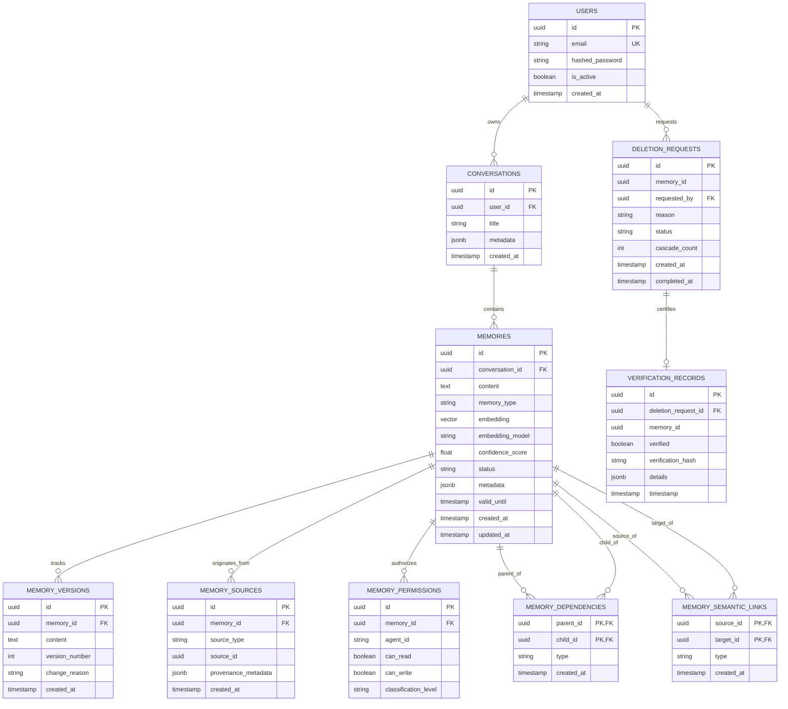
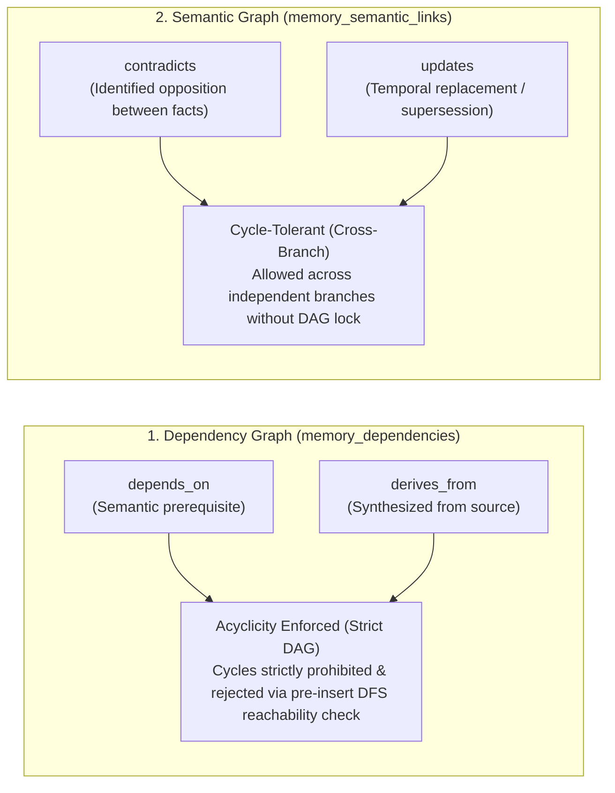
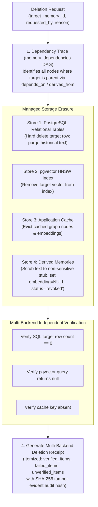
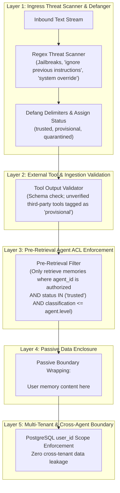

# Knowledge Brain — Phase 1: Comprehensive System Architecture & Foundation Specification

Knowledge Brain is a universal, portable, intelligent, and user-controlled memory infrastructure for AI agents. It bridges heterogeneous agent frameworks (LangGraph, CrewAI, MCP agents) with a persistent, versioned, provenance-tracked, and dependency-aware memory layer.

---

## 1. System Architecture Overview

```mermaid
flowchart TD
    subgraph ClientLayer["1. Client & Agent Layer (Phase 3 Scope)"]
        LG["LangGraph Agents"]
        CR["CrewAI Teams"]
        EXT["External LLMs / MCP Clients"]
        UI["React + Tailwind Dashboard (Vercel)"]
    end

    subgraph InterfaceGateway["2. Interface Gateway Layer"]
        REST["FastAPI REST API\n(JSON over HTTP/2)"]
        MCP_GW["Model Context Protocol (MCP) Gateway\n(/api/mcp/tools/call)"]
    end

    subgraph IngressSecurity["3. Ingress Security & Sanitization Barrier"]
        SCAN["Threat & Injection Scanner"]
        WRAP["Passive Data Tag Wrapper\n(<memory_data is_instruction='false'>)"]
        ACL_PRE["Pre-Retrieval ACL Enforcement\n(agent_id + classification_level)"]
    end

    subgraph CoreEngine["4. Core Knowledge Brain Engine"]
        MC["Memory Compiler\n(5 Cognitive Facets & Normalization)"]
        CD["Conflict & Contradiction Engine\n(Antonym Clash & Decision Updates)"]
        CG["Memory Capsule Generator\n(Intent Retrieval + Token Budget Compaction)"]
        DAF["Dependency-Aware Forgetting Engine\n(Multi-Store Cascade & Tamper-Evident Receipt)"]
    end

    subgraph GraphLayer["5. Dual-Relationship Graph Engine"]
        DEP_DAG["Dependency DAG Table\n(depends_on, derives_from)\n*Strictly Acyclic*"]
        SEM_GRAPH["Semantic Links Table\n(contradicts, updates)\n*Cross-branch / Cyclic Tolerant*"]
    end

    subgraph StorageLayer["6. Persistent Storage Layer (Neon Cloud PostgreSQL)"]
        PG_REL["Relational Store (10 Tables)\n(users, conversations, versions, sources, permissions, dependencies, semantic_links, deletion_audits)"]
        PG_VEC["pgvector Engine\n(1536-dim Embeddings with HNSW Index)"]
    end

    ClientLayer --> InterfaceGateway
    InterfaceGateway --> IngressSecurity
    IngressSecurity --> CoreEngine
    CoreEngine <--> GraphLayer
    CoreEngine <--> StorageLayer
    GraphLayer <--> StorageLayer
```



---

## 2. Database Architecture, Schema Reconciliation & Indexing Strategy

### Schema Reconciliation (8 Entities + 2 Dedicated Relationship Tables = 10 Tables Total)
Knowledge Brain defines **8 primary domain entities** plus **2 separate association tables** to ensure complete physical and logical decoupling between causal dependency graphs and semantic cross-links:
1. `users` (Core Entity: Identity & multi-tenant isolation)
2. `conversations` (Core Entity: Dialogue sessions & context grouping)
3. `memories` (Core Entity: Atomic memory nodes with `Vector(1536)` and model tracking)
4. `memory_versions` (Core Entity: Append-only immutable revision history)
5. `memory_sources` (Core Entity: Provenance tracking & source pointers)
6. `memory_permissions` (Core Entity: Granular cross-agent access control list)
7. `deletion_requests` (Core Entity: Audit request records for right-to-be-forgotten)
8. `verification_records` (Core Entity: Multi-backend deletion receipts & tamper-evident audit hashes)
9. `memory_dependencies` (Association Table: Causal Directed Acyclic Graph - `depends_on`, `derives_from`)
10. `memory_semantic_links` (Association Table: Semantic associations - `contradicts`, `updates`)

### Complete ER Diagram



### Referential Integrity & Cascading Rules
- `conversations.user_id` $\rightarrow$ `users.id` on delete **CASCADE**
- `memories.conversation_id` $\rightarrow$ `conversations.id` on delete **CASCADE**
- `memory_versions.memory_id` $\rightarrow$ `memories.id` on delete **CASCADE**
- `memory_sources.memory_id` $\rightarrow$ `memories.id` on delete **CASCADE**
- `memory_permissions.memory_id` $\rightarrow$ `memories.id` on delete **CASCADE**
- `memory_dependencies.parent_id` & `child_id` $\rightarrow$ `memories.id` on delete **CASCADE**
- `memory_semantic_links.source_id` & `target_id` $\rightarrow$ `memories.id` on delete **CASCADE**
- `verification_records.deletion_request_id` $\rightarrow$ `deletion_requests.id` on delete **CASCADE**

### Indexing Strategy
1. **Relational B-Tree Indexes:**
   - `users(email)`: Unique lookup index for tenant authentication.
   - `conversations(user_id)`: Conversation list filtering by owner.
   - `memories(conversation_id, status)`: Fast composite filtering for active memories.
   - `memories(memory_type)`: Fast categorization filtering (`fact`, `preference`, `decision`, etc.).
   - `memory_versions(memory_id, version_number)`: Sub-millisecond historical revision traversal.
   - `memory_permissions(agent_id, memory_id)`: Pre-retrieval agent authorization lookup.
2. **Graph Relationship Indexes:**
   - `memory_dependencies(parent_id, child_id)`: Composite primary key index.
   - `memory_dependencies(type)`: Index to filter `depends_on` from `derives_from`.
   - `memory_semantic_links(source_id, target_id)`: Composite primary key index.
   - `memory_semantic_links(type)`: Index to filter `contradicts` from `updates`.
3. **pgvector Indexing (Phase 2 Live Database Setup):**
   - HNSW index on `memories.embedding` using `vector_cosine_ops` ($m=16, \text{ef\_construction}=64$) for sub-5ms nearest-neighbor semantic search.

---

## 3. Relationship Graph Architecture: Dependency vs. Semantic Separation



### Acyclic Enforcement on Dependency Relationships
- **Scope:** Cycle checks apply **strictly** to `memory_dependencies` (`depends_on`, `derives_from`). Semantic links (`contradicts`, `updates`) reside in a separate table and do not create causal dependency constraints.
- **Cycle Detection Algorithm:**
  Before writing an edge from Parent $P$ to Child $C$ in `memory_dependencies`:
  1. *Immediate Self-Loop Check:* If $P == C$, reject with `400 Bad Request`.
  2. *Reachability Pre-Check:* Execute a path search starting at $C$ restricted to `memory_dependencies`.
  3. If $P$ is reachable from $C$ ($C \rightsquigarrow P$), adding $P \rightarrow C$ would close a cycle ($C \rightsquigarrow P \rightarrow C$). The operation is aborted and raises:
     ```json
     {"error": "CircularDependencyDetected", "detail": "Cannot add dependency: memory would depend on its own derived output."}
     ```

---

## 4. Deletion and Audit Retention Architecture



### Audit Retention Policy (Zero Sensitive Content in Audit Logs)
- **Deleted Target Memory:** The raw text and embedding are **hard deleted** from `memories`.
- **Historical Versions (`memory_versions`):** Text content in historical versions is erased or replaced with non-sensitive tombstones (`[PURGED_UNDER_RIGHT_TO_BE_FORGOTTEN]`).
- **Derived / Dependent Memories:** Inferences depending on the erased memory are revoked (`status='revoked'`), their embedding is set to `NULL` to prevent vector retrieval, and their text is sanitized to `[REVOKED: Depends on erased memory <UUID>]`.
- **Audit Records (`verification_records`):** **Strictly prohibited from storing deleted text or sensitive content.** The audit record stores only UUIDs, counts, verification statuses, timestamps, and the tamper-evident hash.

### Structured Deletion Receipt Specification
```json
{
  "deletion_request_id": "7b8f9e21-0000-0000-0000-000000000000",
  "target_memory_id": "3c4d5e6f-1111-1111-1111-111111111111",
  "status": "completed",
  "audit_integrity_hash": "a591a6d40bf420404a011733cfb7b190d62c65bf0bcda32b57b277d9ad9f146e",
  "audit_integrity_algorithm": "SHA-256",
  "storage_verification": {
    "verified_items": [
      {"store": "postgresql_relational", "item_id": "3c4d5e6f...", "verified": true},
      {"store": "pgvector_index", "item_id": "3c4d5e6f...", "verified": true},
      {"store": "application_cache", "item_id": "3c4d5e6f...", "verified": true}
    ],
    "failed_items": [],
    "unverified_items": []
  },
  "cascaded_dependencies_revoked": [
    {"derived_memory_id": "9a8b7c6d...", "relationship": "derives_from", "new_status": "revoked"}
  ],
  "timestamp": "2026-11-13T02:00:00Z"
}
```

> **Audit Integrity Clarification:** The SHA-256 hash is an **audit integrity mechanism** providing tamper evidence for the deletion transaction ledger. It is **not** mathematical proof of physical data obliteration on hardware media.

### Limitations Regarding External AI Services and Models
1. **Pre-Trained / Fine-Tuned Model Weights:** If conversation data was used to train or fine-tune an external LLM prior to erasure, Knowledge Brain cannot retroactively modify neural network weights.
2. **Third-Party Inference Logs:** If external LLM APIs (e.g. OpenAI, Google Gemini) logged prompts on their servers for compliance or debugging, those logs reside outside Knowledge Brain's administrative domain.
3. **In-Flight Agent Context:** If an autonomous agent currently has an active conversation turn loaded into its local RAM context, that memory persists until that specific agent process turn finishes.

---

## 5. Multi-Layer Memory Security Architecture



### Security Layers Detailed:
1. **Separation of Instructions and Memory:** Memory content is treated strictly as passive data. Content in capsules is enclosed in `<memory_data is_instruction="false">`. System prompt contracts mandate that agents never evaluate memory content as executable system instructions.
2. **Pre-Retrieval Permission Enforcement:** Query filters in `memory_permissions` execute **before** vector search and graph expansion. Memories are excluded if `agent_id` lacks authorization or clearance level.
3. **External Tool Validation:** Ingested tool outputs are validated against Pydantic schemas and tagged as `provisional` until verified by human interaction.
4. **Trust Lifecycle State Machine:**
   - `trusted`: Standard verified human user conversation.
   - `provisional`: Ingested from external tools or web scrapes.
   - `quarantined`: Threat signatures detected; defanged and isolated.
   - `revoked`: Soft-deleted or invalidated due to dependency cascades.
5. **Cross-Agent Isolation:** Every query enforces `user_id` multi-tenant boundaries and granular agent permissions (`classification_level` $\in$ `standard`, `confidential`, `restricted`).

---

## 6. Vector Search Architecture

- **Why 1536 Dimensions?** Chosen to natively match standard modern embedding models (e.g., OpenAI `text-embedding-3-small` and `text-embedding-ada-002`). It provides an optimal balance of high semantic density, compact vector storage, and sub-5ms cosine retrieval.
- **Intended Embedding Model:** Primary default is OpenAI `text-embedding-3-small`. Architecture is abstracted to support pluggable local embeddings (e.g. `BAAI/bge-small-en-v1.5` or `sentence-transformers`).
- **Embedding Versioning & Model Migration:**
  `memories.embedding_model` records the specific model version used. When changing models:
  1. Set `EMBEDDING_DIM` in environment configuration.
  2. Database migration script introduces a new vector column (e.g., `embedding_v2`).
  3. A background task re-embeds stored memories in batches.
  4. Once complete, queries switch to `embedding_v2` and the legacy vector column is retired.
- **Index Selection (HNSW vs. IVFFlat):**
  Knowledge Brain selects **HNSW (Hierarchical Navigable Small World)**:
  - *IVFFlat* requires an upfront training phase and degrades as new vectors are incrementally added.
  - *HNSW* supports dynamic, continuous real-time insertions without recall degradation, delivering $< 5\text{ms}$ latency at $> 98\%$ recall.
- **Unconfigured Database Fallback (Strict 503 Contract):**
  When `DATABASE_URL` is unset or contains placeholders (as in `.env.example`), the database engine safely yields `None`. Any operation requiring persistent storage (`POST /api/memories`, `POST /api/capsules/generate`, `POST /api/forgetting/request-deletion`, `GET /api/memories`) returns an explicit **`503 Service Unavailable`** with:
  ```json
  {
    "error": "DatabaseNotConfigured",
    "message": "Persistent storage is currently unavailable. Configure DATABASE_URL in .env to enable memory persistence."
  }
  ```
  The API never reports false success for unpersisted operations.

---

## 7. Implementation & Testing Boundaries Inventory

### Staged Phase 2 Code Modules (Cataloged Drafts — Awaiting Approval)
The following modules were staged during backend consolidation and are held in draft state:
- [`backend/app/compiler/sanitizer.py`](file:///d:/5B%20assignments/CV/DevX/backend/app/compiler/sanitizer.py): Threat scanning and passive tagging.
- [`backend/app/compiler/extractor.py`](file:///d:/5B%20assignments/CV/DevX/backend/app/compiler/extractor.py): Multi-facet heuristic extraction.
- [`backend/app/conflict/detector.py`](file:///d:/5B%20assignments/CV/DevX/backend/app/conflict/detector.py): Antonym opposition detection.
- [`backend/app/forgetting/engine.py`](file:///d:/5B%20assignments/CV/DevX/backend/app/forgetting/engine.py): NetworkX cascade graph deletion.
- [`backend/app/capsule/generator.py`](file:///d:/5B%20assignments/CV/DevX/backend/app/capsule/generator.py): Token-budgeted capsule synthesis.
- [`backend/app/services/memory_service.py`](file:///d:/5B%20assignments/CV/DevX/backend/app/services/memory_service.py): Persistence and provenance orchestration.

### Formal Test Classification Matrix

| Test Suite | Test Type | Execution Target | Mocked vs. Real | Status |
|---|---|---|---|:---:|
| **Schema Validation** | Unit Test | Pydantic v2 Models (`schemas.py`) | Real Local Execution | **PASSED** |
| **Model Metadata Compilation** | Database / ORM Test | SQLAlchemy Base Metadata (`models.py`) | Real Local Execution (10 tables) | **PASSED** |
| **FastAPI Route Mapping** | API Test | Router registration (`api.py`, `main.py`) | Real Local Execution | **PASSED** |
| **Database Safe Fallback & 503 Contract** | Unit / Integration Test | `database.py` health check & require_db | Real Local Execution | **PASSED** |
| **Uvicorn Server Startup** | End-to-End System Test | Native Windows Process (`start.ps1`) | Real HTTP Loopback (`/docs` 200 OK) | **PASSED** |
| **Live Neon DB Querying** | Database Test | Remote Neon PostgreSQL | **UNCONFIGURED** (Pending `.env`) | **NOT TESTED** |
| **Live pgvector Search** | Database / Vector Test | Remote pgvector HNSW Index | **UNCONFIGURED** (Pending `.env`) | **NOT TESTED** |
| **Live LLM Semantic Extraction** | Integration Test | OpenAI / Gemini API | **UNCONFIGURED** (Pending API Key) | **NOT TESTED** |
| **LangGraph / CrewAI Agents** | E2E Agent Integration | Multi-Agent MCP Workflow | **NOT STARTED** (Phase 3 Scope) | **NOT TESTED** |
| **React Frontend Client** | UI / E2E Test | React + Tailwind Dashboard | **NOT STARTED** (Phase 3 Scope) | **NOT TESTED** |

---

## 8. Exact File Paths for Reference

- **Architecture Document:** [`architecture.md`](file:///C:/Users/suyas/.gemini/antigravity/brain/c378a092-b5f6-4c5e-aff5-c0c893eb1d3e/architecture.md)
- **Database Schema & Models (10 Tables):** [`backend/app/models.py`](file:///d:/5B%20assignments/CV/DevX/backend/app/models.py)
- **API Contracts & Endpoint Definitions:** [`backend/app/api.py`](file:///d:/5B%20assignments/CV/DevX/backend/app/api.py) and [`backend/app/schemas.py`](file:///d:/5B%20assignments/CV/DevX/backend/app/schemas.py)
- **Database Configuration & 503 Contract:** [`backend/app/database.py`](file:///d:/5B%20assignments/CV/DevX/backend/app/database.py)
- **Development Status Ledger:** [`DEVELOPMENT_STATUS.md`](file:///d:/5B%20assignments/CV/DevX/DEVELOPMENT_STATUS.md)

---

*This concludes the complete revised review package. No Phase 2 or Phase 3 implementation has begun.*

**I am stopped and awaiting your formal Phase 1 approval.**
