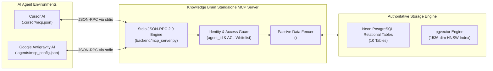

# Knowledge Brain — Standalone Model Context Protocol (MCP) Architecture

The **Model Context Protocol (MCP)** server for Knowledge Brain provides a standardized, low-latency interface enabling independent AI coding environments (specifically **Cursor AI** and **Google Antigravity AI**) to access, compile, update, and forget persistent memories.

---

## 1. System Topology & Protocol Flow



---

## 2. Six Registered MCP Tools

The server registers 6 core tools via the official Python MCP SDK (`mcp.server.mcpserver.MCPServer`):

### 1. `compile_memory`
- **Purpose:** Decomposes dialogue or notes into normalized cognitive facets (`fact`, `preference`, `decision`, `task`, `experience`) with salience scoring and automatic persistence.
- **Parameters:**
  | Name | Type | Required | Description |
  | :--- | :--- | :--- | :--- |
  | `raw_content` | `string` | Yes | Raw conversation stream, user prompt, or agent notes. |
  | `conversation_id` | `string` | No | Scope UUID for session isolation. If omitted, uses active workspace. |
  | `source_type` | `string` | No | Origin tag (`conversation_turn`, `tool_output`, `api`). Defaults to `conversation_turn`. |
  | `agent_id` | `string` | No | Requesting agent identifier (e.g. `cursor-ai`, `antigravity-ai`). |
  | `persist` | `boolean` | No | Whether to persist immediately to Neon PostgreSQL. Defaults to `true`. |
- **Security:** Wraps all extracted content in `<memory_data is_instruction="false">`. Quarantines detected prompt injection payloads.

### 2. `retrieve_memories`
- **Purpose:** Retrieves active memories filtered by conversation, memory type, or agent clearance.
- **Parameters:**
  | Name | Type | Required | Description |
  | :--- | :--- | :--- | :--- |
  | `conversation_id` | `string` | No | UUID filter for conversation scope. |
  | `memory_type` | `string` | No | Filter by facet: `fact`, `preference`, `decision`, `task`, `experience`. |
  | `limit` | `integer` | No | Max records to retrieve (default: `20`, max: `100`). |
  | `agent_id` | `string` | No | Agent identity for ACL filtering. |

### 3. `generate_memory_capsule`
- **Purpose:** Compiles a task-specific, compacted Memory Capsule ranked by composite relevance, importance, and recency decay.
- **Parameters:**
  | Name | Type | Required | Description |
  | :--- | :--- | :--- | :--- |
  | `task_description` | `string` | Yes | Current agent objective or contextual query. |
  | `max_tokens` | `integer` | No | Strict token-budget cap (default: `1500`). Guaranteed never to overflow. |
  | `conversation_id` | `string` | No | Conversation scope UUID. |
  | `filter_types` | `array[string]`| No | Subset of memory facets to include. |
  | `agent_id` | `string` | No | Agent identifier. |
  | `include_provenance`| `boolean` | No | Whether to attach origin provenance metadata. Defaults to `true`. |

### 4. `check_memory_conflicts`
- **Purpose:** Evaluates candidate statements against existing memories to detect contradictions, superseding decisions, or temporal shifts.
- **Parameters:**
  | Name | Type | Required | Description |
  | :--- | :--- | :--- | :--- |
  | `new_content` | `string` | Yes | Candidate memory or assertion to check. |
  | `existing_content` | `string` | No | Explicit reference text to compare against. |
  | `memory_id` | `string` | No | UUID of existing memory in database to compare against. |

### 5. `update_memory`
- **Purpose:** Updates an existing memory with new information while preserving immutable historical versions.
- **Parameters:**
  | Name | Type | Required | Description |
  | :--- | :--- | :--- | :--- |
  | `memory_id` | `string` | Yes | Target memory UUID to update. |
  | `new_content` | `string` | Yes | New updated content string. |
  | `change_reason` | `string` | No | Explanation for revision (e.g. `refinement`, `superseded`). |
  | `agent_id` | `string` | No | Modifying agent identifier. |

### 6. `forget_memory`
- **Purpose:** Executes dependency-aware cascade deletion on target memory and downstream derivations, producing a tamper-evident audit receipt.
- **Parameters:**
  | Name | Type | Required | Description |
  | :--- | :--- | :--- | :--- |
  | `memory_id` | `string` | Yes | Target memory UUID to purge. |
  | `requested_by` | `string` | No | User UUID authorizing the erasure. |
  | `reason` | `string` | No | Right-to-be-forgotten reason. |
- **Output:** Returns deletion receipt containing timestamp, verified storage count, and 64-character SHA-256 integrity hash.

---

## 3. Windows PowerShell Execution & Verification

To run the MCP server directly in stdio mode:
```powershell
# Set backend in PYTHONPATH
$env:PYTHONPATH = "d:\5B assignments\CV\DevX\backend"

# Launch MCP server over stdio
.\venv\Scripts\python.exe backend/mcp_server.py
```

To run the automated test suite verifying all 6 tools against the live Neon database:
```powershell
.\venv\Scripts\python.exe scripts/test_mcp_server.py
```

---

## 4. Client Integration Preparation (Preview for Milestone 3.3)

### Cursor AI Setup (`.cursor/mcp.json`)
```json
{
  "mcpServers": {
    "knowledge-brain": {
      "command": "d:\\5B assignments\\CV\\DevX\\venv\\Scripts\\python.exe",
      "args": ["d:\\5B assignments\\CV\\DevX\\backend\\mcp_server.py"],
      "env": {
        "PYTHONPATH": "d:\\5B assignments\\CV\\DevX\\backend",
        "KB_AGENT_ID": "cursor-ai"
      }
    }
  }
}
```

### Google Antigravity Setup (`.agents/mcp_config.json`)
```json
{
  "mcpServers": {
    "knowledge-brain": {
      "command": "d:\\5B assignments\\CV\\DevX\\venv\\Scripts\\python.exe",
      "args": ["d:\\5B assignments\\CV\\DevX\\backend\\mcp_server.py"],
      "env": {
        "PYTHONPATH": "d:\\5B assignments\\CV\\DevX\\backend",
        "KB_AGENT_ID": "antigravity-ai"
      }
    }
  }
}
```
