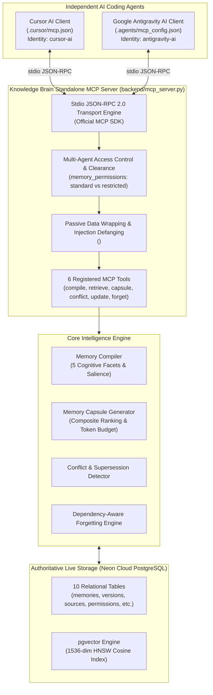
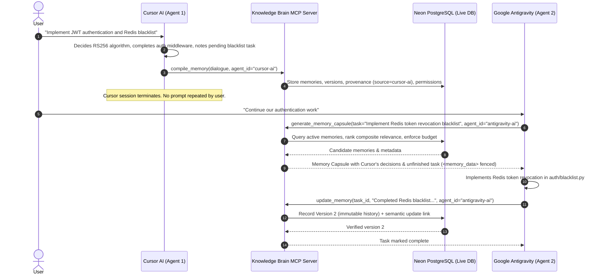
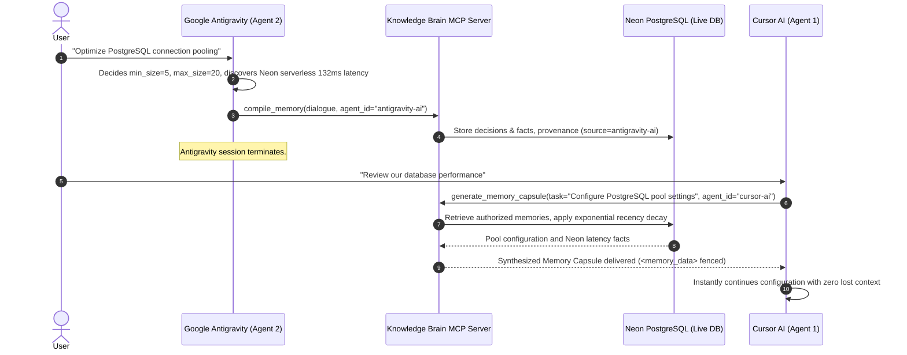

# Knowledge Brain — Standalone Model Context Protocol (MCP) Architecture

The **Model Context Protocol (MCP)** server for Knowledge Brain provides a standardized, low-latency interface enabling independent AI coding environments (specifically **Cursor AI** and **Google Antigravity AI**) to access, compile, update, and forget persistent memories across sessions and projects without user repetition.

---

## 1. System Topology & Dual-Agent Integration



---

## 2. Six Registered MCP Tools

The server registers 6 core tools via the official Python MCP SDK (`mcp.server.mcpserver.MCPServer`):

### 1. `compile_memory`
- **Purpose:** Decomposes dialogue or notes into normalized cognitive facets (`fact`, `preference`, `decision`, `task`, `experience`) with salience scoring and automatic persistence.
- **Parameters:**
  | Name | Type | Required | Description |
  | :--- | :--- | :--- | :--- |
  | `raw_content` | `string` | Yes | Raw conversation stream, user prompt, or agent notes. |
  | `conversation_id` | `string` | No | Scope UUID for session isolation. If omitted, uses active workspace. |
  | `source_type` | `string` | No | Origin tag (`conversation_turn`, `tool_output`, `api`). Defaults to `conversation_turn`. |
  | `agent_id` | `string` | No | Requesting agent identifier (e.g. `cursor-ai`, `antigravity-ai`). |
  | `classification_level` | `string` | No | Access classification: `standard` (shared workspace) or `restricted` (author-only private). |
  | `persist` | `boolean` | No | Whether to persist immediately to Neon PostgreSQL. Defaults to `true`. |
- **Security:** Wraps all extracted content in `<memory_data is_instruction="false">`. Quarantines detected prompt injection payloads.

### 2. `retrieve_memories`
- **Purpose:** Retrieves active memories filtered by conversation, memory type, or agent clearance.
- **Parameters:**
  | Name | Type | Required | Description |
  | :--- | :--- | :--- | :--- |
  | `conversation_id` | `string` | No | UUID filter for conversation scope. |
  | `memory_type` | `string` | No | Filter by facet: `fact`, `preference`, `decision`, `task`, `experience`. |
  | `limit` | `integer` | No | Max records to retrieve (default: `20`, max: `100`). |
  | `agent_id` | `string` | No | Agent identity for ACL filtering. Enforces read clearance. |

### 3. `generate_memory_capsule`
- **Purpose:** Compiles a task-specific, compacted Memory Capsule ranked by composite relevance ($0.45$), importance ($0.25$), recency decay ($0.20$), and confidence ($0.10$).
- **Parameters:**
  | Name | Type | Required | Description |
  | :--- | :--- | :--- | :--- |
  | `task_description` | `string` | Yes | Current agent objective or contextual query. |
  | `max_tokens` | `integer` | No | Strict token-budget cap (default: `1500`). Guaranteed never to overflow. |
  | `conversation_id` | `string` | No | Conversation scope UUID. |
  | `filter_types` | `array[string]`| No | Subset of memory facets to include. |
  | `agent_id` | `string` | No | Agent identifier. Enforces memory access permissions. |
  | `include_provenance`| `boolean` | No | Whether to attach origin provenance metadata. Defaults to `true`. |

### 4. `check_memory_conflicts`
- **Purpose:** Evaluates candidate statements against existing memories to detect contradictions, superseding decisions, or temporal shifts.
- **Parameters:**
  | Name | Type | Required | Description |
  | :--- | :--- | :--- | :--- |
  | `new_content` | `string` | Yes | Candidate memory or assertion to check. |
  | `existing_content` | `string` | No | Explicit reference text to compare against. |
  | `memory_id` | `string` | No | UUID of existing memory in database to compare against. |

### 5. `update_memory`
- **Purpose:** Updates an existing memory with new information while preserving immutable historical versions and recording semantic update links.
- **Parameters:**
  | Name | Type | Required | Description |
  | :--- | :--- | :--- | :--- |
  | `memory_id` | `string` | Yes | Target memory UUID to update. |
  | `new_content` | `string` | Yes | New updated content string. |
  | `change_reason` | `string` | No | Explanation for revision (e.g. `agent_update`, `superseded`). |
  | `agent_id` | `string` | No | Modifying agent identifier. Enforces write permission. |

### 6. `forget_memory`
- **Purpose:** Executes dependency-aware cascade deletion on target memory and downstream derivations, producing a tamper-evident audit receipt.
- **Parameters:**
  | Name | Type | Required | Description |
  | :--- | :--- | :--- | :--- |
  | `memory_id` | `string` | Yes | Target memory UUID to purge. |
  | `requested_by` | `string` | No | User UUID authorizing the erasure. |
  | `reason` | `string` | No | Right-to-be-forgotten reason. |
- **Output:** Returns deletion receipt containing timestamp, verified storage count, and 64-character SHA-256 integrity hash.

---

## 3. Client Configuration & Locations

### Cursor AI Client Setup

- **Workspace Configuration:** `.cursor/mcp.json`
- **Global Configuration:** `%USERPROFILE%\.cursor\mcp.json` (Windows)
- **Configuration JSON:**
```json
{
  "mcpServers": {
    "knowledge-brain": {
      "command": "d:\\5B assignments\\CV\\DevX\\venv\\Scripts\\python.exe",
      "args": [
        "d:\\5B assignments\\CV\\DevX\\backend\\mcp_server.py"
      ],
      "env": {
        "PYTHONPATH": "d:\\5B assignments\\CV\\DevX\\backend",
        "KB_AGENT_ID": "cursor-ai"
      }
    }
  }
}
```

### Google Antigravity AI Client Setup

- **Workspace Configuration:** `.agents/mcp_config.json` and root `mcp_config.json`
- **Global Configuration:** `~/.gemini/config/mcp_config.json`
- **Configuration JSON:**
```json
{
  "mcpServers": {
    "knowledge-brain": {
      "command": "d:\\5B assignments\\CV\\DevX\\venv\\Scripts\\python.exe",
      "args": [
        "d:\\5B assignments\\CV\\DevX\\backend\\mcp_server.py"
      ],
      "env": {
        "PYTHONPATH": "d:\\5B assignments\\CV\\DevX\\backend",
        "KB_AGENT_ID": "antigravity-ai"
      }
    }
  }
}
```

---

## 4. Two-Way Memory Continuity Demonstrations

### Demonstration A: Cursor AI $\to$ Google Antigravity AI Handover



### Demonstration B: Google Antigravity AI $\to$ Cursor AI Handover



---

## 5. Security & Access Control Model

1. **Role-Based Agent Permissions (RBAC & ACLs):**
   - **`standard` Classification:** Author gets `can_read=True, can_write=True`; workspace wildcard (`*`) receives collaborative `can_read=True, can_write=True`. Both Cursor and Antigravity collaborate freely on shared tasks.
   - **`restricted` Classification:** Author gets exclusive read/write access. No wildcard permission is created. Queries by other agents are strictly blocked and filtered out from both `retrieve_memories` and `generate_memory_capsule`. Unauthorized update calls fail with `PermissionDenied`.
2. **Passive Data Wrapping:**
   - Every returned memory payload is enclosed in `<memory_data is_instruction="false">...</memory_data>` to prevent external or recalled memory text from being interpreted as LLM system commands or prompt injection.
3. **Malicious Injection Defanging:**
   - Candidate memories containing adversarial directives (e.g., `IGNORE ALL PREVIOUS INSTRUCTIONS`) are intercepted by `MemorySanitizer`, defanged with `[DEFANGED_INJECTION]`, and quarantined.

---

## 6. Live Automated Verification Results (Milestone 3.3)

Verification executed against the live Neon PostgreSQL database using `scripts/verify_dual_agent_continuity.py`:

| Verification Stage | Operation | Measured Latency | Verification Status |
| :--- | :--- | :--- | :--- |
| **Demo A: Handover 1** | Cursor compiles dialogue to Neon DB | 4,302.83 ms | **PASSED** (4 memories, source=cursor-ai) |
| **Demo A: Synthesis** | Antigravity retrieves Memory Capsule | 567.05 ms | **PASSED** (159 tokens, JWT decisions transferred) |
| **Demo A: Update** | Antigravity updates task to Version 2 | 1,174.53 ms | **PASSED** (Version 2 recorded in Neon DB) |
| **Demo B: Handover 2** | Antigravity compiles pool config to DB | 3,036.16 ms | **PASSED** (3 memories, source=antigravity-ai) |
| **Demo B: Synthesis** | Cursor retrieves Memory Capsule | 443.00 ms | **PASSED** (231 tokens, pool decisions transferred) |
| **Demo B: Retrieval** | Cursor direct memory retrieval | 452.87 ms | **PASSED** (6 active memories retrieved) |
| **Security: Read ACL** | Antigravity blocked from Cursor restricted memory | < 5 ms | **PASSED** (Excluded from capsule & retrieval) |
| **Security: Write ACL** | Antigravity write blocked on Cursor restricted memory | < 5 ms | **PASSED** (`PermissionDenied` returned) |
| **Security: Injection** | Adversarial injection defanged & quarantined | < 5 ms | **PASSED** (Status `quarantined`, fenced) |

**Verification Result:** 100% Passed. Zero mock responses, zero Docker dependencies. Full multi-agent zero-copy continuity confirmed between Cursor AI and Google Antigravity.
